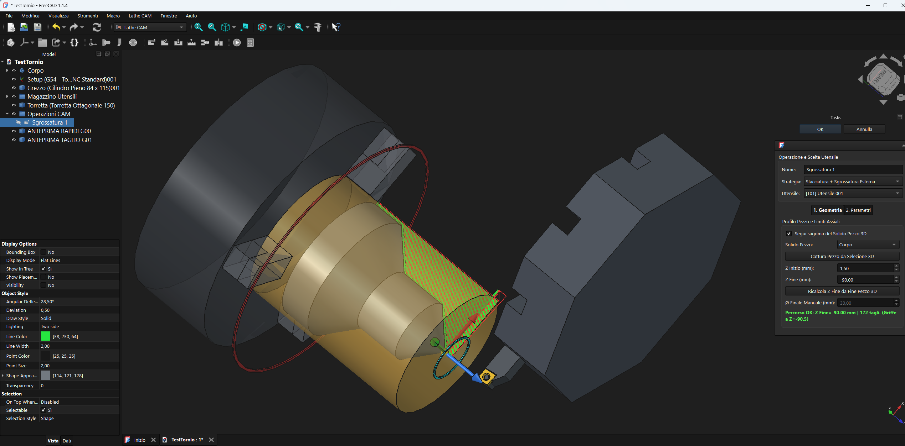

# Lathe Workbench for FreeCAD

## Screenshots & Simulation

*Figure 1: Lathe Workbench main interface and toolpaths.*

👉 **[Click here to download and watch the simulation video (Simulation.mp4)](docs/Simulation.mp4)**
*Figure 2: Real-time 3D simulation of turning operations.*

The **Lathe Workbench** is a specialized external CAM environment for [FreeCAD](https://www.freecad.org) built to handle complex CNC turning workflows. Unlike standard milling workbenches, this workbench is tailored specifically for lathe operations—including roughing, finishing, grooving, parting, drilling, threading, turret indexing, and custom G-code post-processing.

---

## Features

- **Turning Operations**: Dedicated tools for roughing, finishing, grooving, parting, drilling, and threading.
- **Tool & Turret Management**: Comprehensive interface to define cutting tools, inserts, holders, and turret stations.
- **Simulation & Verification**: Integrated simulation tools to preview toolpaths and check against stock geometry.
- **Stock & Setup Definition**: Fast definition of raw material stock and machine coordinate setups.
- **Custom Post-Processing**: Converts internal toolpaths into machine-ready G-code using customizable JSON post profiles.
- **Multi-language Support**: Built-in internationalization framework for localized UI and messages.

---

## Installation

### Manual Installation
1. Locate your FreeCAD `Mod` directory:
   - **Linux**: `~/.local/share/FreeCAD/Mod/`
   - **Windows**: `%APPDATA%\FreeCAD\Mod\`
   - **macOS**: `~/Library/Preferences/FreeCAD/Mod/`
2. Clone or extract this repository's folder (named `LatheCAM`) inside your `Mod` directory.
3. Restart FreeCAD. The **Lathe** workbench will appear in the workbench dropdown selector.

---

## Command Reference

| Icon | Tool | Module | Description |
| :---: | :--- | :--- | :--- |
|  | **Setup** | `LatheSetup.py` | Sets up job boundaries, safety clearances, and spindle speed limits. |
|  | **Stock** | `LatheStock.py` | Defines raw stock dimensions, allowances, and material properties. |
|  | **Tool Manager** | `LatheToolManager.py` | Interface for creating and modifying cutting tools and inserts. |
|  | **Turret** | `LatheTurret.py` | Assigns tools to specific turret slots for multi-step operations. |
|  | **Roughing** | `LatheRoughing.py` | Executes rough turning cycles for rapid bulk material removal. |
|  | **Finishing** | `LatheFinishing.py` | Performs final profile passes for precise dimensional tolerances. |
|  | **Grooving** | `LatheGrooving.py` | Cuts internal, external, or face grooves. |
|  | **Parting** | `LatheParting.py` | Specialized cut-off toolpath with feed reduction near the center line. |
|  | **Drilling** | `LatheDrilling.py` | Manages axial drilling, pecking, and boring cycles. |
|  | **Threading** | `LatheThreading.py` | Generates metric, imperial, or custom thread profiles. |
|  | **Simulation** | `LatheSimulation.py` | Runs graphical simulation of toolpaths against stock geometry. |
|  | **Post-Process** | `LathePostProcessor.py` | Exports operations to machine-ready G-code. |

---

## Project Structure

The workbench uses a clean, modular structure following FreeCAD Addon standards:

    LatheCAM/
    ├── docs/                    # Documentation assets (screenshots and Simulation.mp4)
    ├── icons/                   # SVG toolbar icons
    ├── MachineLibrary/          # Machine definition profiles
    ├── StockLibrary/            # Stock material profiles
    ├── ToolLibrary/             # Tool and insert databases
    ├── TurretLibrary/           # Turret configuration files
    ├── translations/            # I18n localization files (EN, IT, ES, DE)
    ├── post_profiles_ecam.json  # G-code post-processor configurations
    ├── InitGui.py               # Workbench initialization for FreeCAD
    ├── Lathe*.py                # Main operation modules
    ├── README.md                # This documentation
    └── LICENSE                  # LGPL License file

---

## Feedback and Contributions

This is a brand new software project in active development. If you encounter bugs, have suggestions, or want to propose improvements, please do not hesitate to share them! 

*Please note: I develop this project in my free time and I am not at the computer every day. My response times may vary from very quick to a few days. Thank you for your patience!*

To keep everything organized and avoid direct private messages, please use the following official channels:
- Open an **[Issue](https://github.com/tuo-username/nome-tuo-repo/issues)** on GitHub for bug reports or specific errors.
- Start or join a conversation in the **[GitHub Discussions](https://github.com/tuo-username/nome-tuo-repo/discussions)** section for ideas and general feedback.
- Join the community discussion on the official **[FreeCAD Forum](https://forum.freecad.org/)**.

---

## License

This project is open-source and released under the **GNU Lesser General Public License v2.0 or later (LGPL-2.0-or-later)**. See the `LICENSE` file for details. Textual documentation is provided under CC-BY-3.0.
